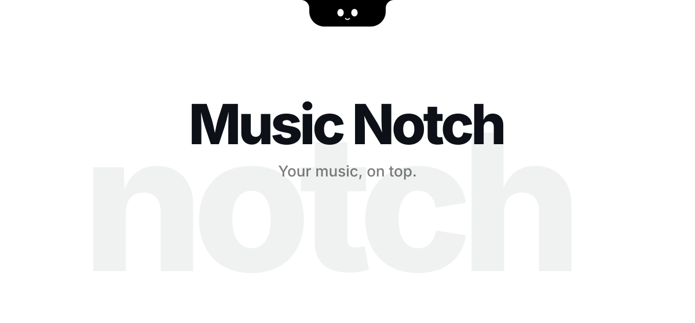

<p align="center"></p>

<p align="center">A tiny island with a face. It plays what you play.</p>

<p align="center"><a href="https://github.com/riteshroshann/music-notch/releases/latest/download/Music-Notch-win.exe"><b>Download for Windows</b></a> · <a href="https://riteshroshann.github.io/music-notch/">Website</a></p>

<br>

**Install.** Windows may warn you. More info, then Run anyway.
**Play.** Spotify, any browser, anything. It drops in.
**Click.** It opens. Right-click for settings. Uninstall from Apps.

<br>

```
bun install && just dev
```

<sub>Engineered by Ritesh Roshan · MIT · <a href="https://riteshroshann.github.io/music-notch/privacy.html">Privacy</a> · <a href="https://riteshroshann.github.io/music-notch/terms.html">Terms</a></sub>
